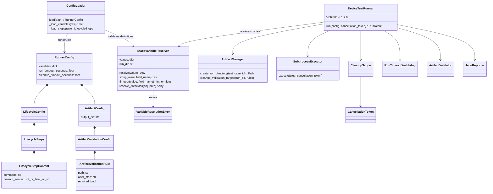
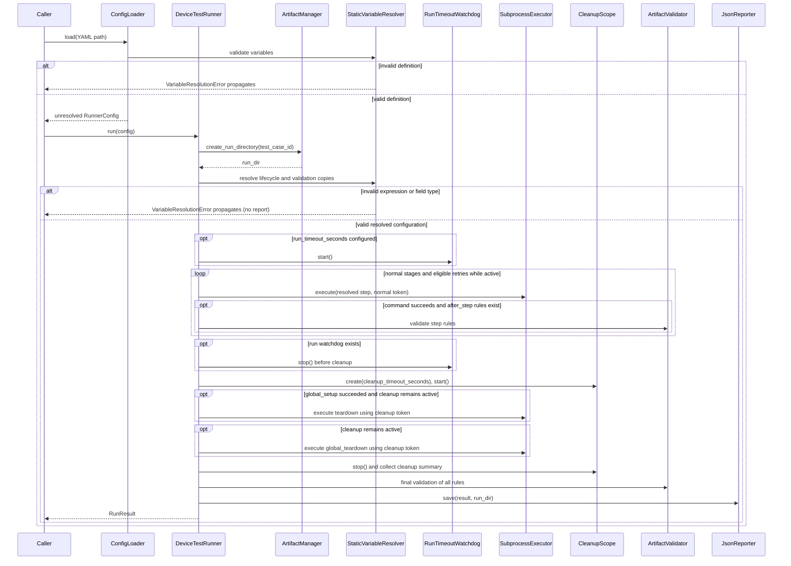

# Device Test Runner v1.7.0 Architecture

Version scope: Static Variable Substitution. Source baseline: `194faf3` plus the inspected working tree, compared with the preceding cleanup implementation and local Git history. This describes current implementation, not a published release.

## Components and data flow

`ConfigLoader.load()` reads YAML, validates `variables` through `StaticVariableResolver`, and stores a copy in `RunnerConfig`. It retains command, timeout and validation path templates. Missing variables default to `{}`; null is rejected. `LifecycleStepContent.timeout_second` permits `int | float | str` during configuration construction.

`DeviceTestRunner.run(config, cancellation_token=None)` creates a run directory through `ArtifactManager`, then resolves lifecycle and artifact validation dataclasses using that directory. `dataclasses.replace()` creates a new configuration; the caller's original templates remain intact. A second call to `run()` resolves them against the new directory. Directory names include UTC microseconds; this reduces same-second collisions but is not an atomic uniqueness guarantee.

Resolution finishes before the run watchdog starts or any step executes. All lifecycle stages and all validation rule paths are checked eagerly, including cleanup and `after_step` rules. Only command, timeout_second and validation path are substituted. `artifact.output_dir` is required before directory creation and is outside this scope.

## Execution sequence

This diagram describes controlled execution paths. Unexpected Python exceptions can bypass finalization; it does not imply report generation for all exceptions.

## Resolver contract

`resolve()` accepts non-string values unchanged. Whole placeholders return the declared scalar type; embedded placeholders convert looked-up values with `str()`. Only `vars.NAME` and `run.dir` are recognized; whitespace around the expression is allowed. Names follow `[A-Za-z_][A-Za-z0-9_]*`.

`string()` requires a string result. `timeout()` requires an exact int or float type, a value greater than zero, and finiteness for floats; bool and numeric strings are rejected. Definition validation allows float values generally; finiteness is enforced when a value is used as a timeout.

`resolve_dataclass()` accepts instances named LifecycleConfig, LifecycleSteps, LifecycleStepContent, ArtifactValidationConfig and ArtifactValidationRule. It dispatches by class name, allowing the test-local dataclasses used by resolver unit tests. Unsupported classes and dataclass types raise TypeError. Error field labels include the configured path, stage and list index for field type failures; expression lookup failures identify the expression/name but do not always include the field path.

## Cleanup, retry and reporting

The normal scope uses the caller token and optional run watchdog. Cleanup uses a fresh shared token and optional independent deadline; teardown eligibility follows global setup success. Ordinary cleanup failures allow subsequent cleanup steps. Cancellation prevents new cleanup work. Final validation runs after controlled cleanup and evaluates all rules.

Required artifact failures affect attempt/run success; optional failures remain diagnostic. Retry eligibility depends on failure type, configured retry_on and remaining attempts. Retry target cleanup uses resolved paths but retains the existing run-directory safety boundary.

Run cancellation determines CANCELLED or TIMED_OUT ahead of cleanup/artifact failures. Step timeout remains TIMEOUT; cleanup scope timeout records cleanup_summary. Resolved commands and validation paths appear in result.json. Metadata.runner_version uses DeviceTestRunner.VERSION (1.7.0); declared variables are not added to the report schema.

## Compatibility and limits

Existing YAML without templates remains usable when its commands, paths and timeouts satisfy the resolver's field validation. Strings containing `${{` are now treated as template syntax. Numeric strings and other invalid step timeouts fail before execution. Python configurations passed through run() receive the same allowlisted field checks.

No recursive substitution, literal escaping, arithmetic, environment/secret namespaces, runtime step outputs or arbitrary field traversal is implemented. Substitution does not escape shell arguments. Resolution errors propagate before work starts and may leave an empty run directory without result.json.

POSIX process termination, reader draining, detached descendants, exception-safe finalization and CLI TIMED_OUT exit code limitations remain. See the [user manual](../user_manual.md), [static variable guide](../static_variable_substitution.md), [test matrix](../test_matrix/test_matrix_v1.7.0.md) and [completion record](../definition_of_done/definition_of_done_v1.7.0.md).
