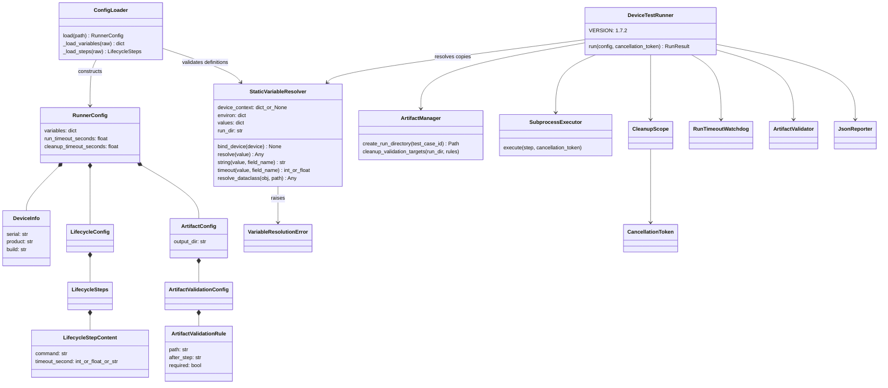
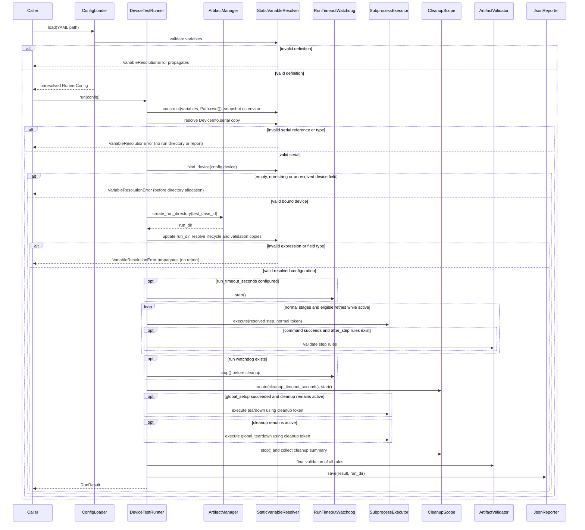

# Device Test Runner v1.7.2 Architecture

Version scope: Device Runtime Context. Source `940fe66`, tests `2aeb559`, draft guide `278e012`; local working tree documentation, not a published release.

## Components and data flow

`ConfigLoader.load()` reads YAML, validates `variables` through `StaticVariableResolver`, and stores a copy in `RunnerConfig`. It retains command, timeout and validation path templates. Missing variables default to `{}`; null is rejected. `LifecycleStepContent.timeout_second` permits `int | float | str` during configuration construction.

`DeviceTestRunner.run(config, cancellation_token=None)` constructs one resolver with an environment snapshot and Path.cwd(), resolves DeviceInfo.serial, validates and binds all three device fields once, creates the run directory through ArtifactManager, then updates that same resolver.run_dir and resolves lifecycle and artifact validation dataclasses. `dataclasses.replace()` creates a new configuration; the caller's original templates remain intact. A second call to `run()` resolves them against the new directory. Directory names include UTC microseconds; this reduces same-second collisions but is not an atomic uniqueness guarantee.

Resolution finishes before the run watchdog starts or any step executes. All lifecycle stages and all validation rule paths are checked eagerly, including cleanup and `after_step` rules. Only device.serial, command, timeout_second and validation path are substituted. Device serial resolution errors precede run directory allocation; later field errors can leave an empty directory. `artifact.output_dir` is required before directory creation and is outside this scope.

## Execution sequence

This diagram describes controlled execution paths. Unexpected Python exceptions can bypass finalization; it does not imply report generation for all exceptions.

## Resolver contract

`resolve()` accepts non-string values unchanged. Whole placeholders return the declared scalar type; embedded placeholders convert looked-up values with `str()`. `vars.NAME`, `env.NAME`, `run.dir` and `device.serial/product/build` are recognized; whitespace around the expression is allowed. Names follow `[A-Za-z_][A-Za-z0-9_]*`.

`string()` requires a string result. `timeout()` requires an exact int or float type, a value greater than zero, and finiteness for floats; bool and numeric strings are rejected. Definition validation allows float values generally; finiteness is enforced when a value is used as a timeout.

`resolve_dataclass()` accepts instances named DeviceInfo, LifecycleConfig, LifecycleSteps, LifecycleStepContent, ArtifactValidationConfig and ArtifactValidationRule. It dispatches by class name, allowing the test-local dataclasses used by resolver unit tests. Unsupported classes and dataclass types raise TypeError. Error field labels include the configured path, stage and list index for field type failures; expression lookup failures identify the expression/name but do not always include the field path.

## Cleanup, retry and reporting

The normal scope uses the caller token and optional run watchdog. Cleanup uses a fresh shared token and optional independent deadline; teardown eligibility follows global setup success. Ordinary cleanup failures allow subsequent cleanup steps. Cancellation prevents new cleanup work. Final validation runs after controlled cleanup and evaluates all rules.

Required artifact failures affect attempt/run success; optional failures remain diagnostic. Retry eligibility depends on failure type, configured retry_on and remaining attempts. Retry target cleanup uses resolved paths but retains the existing run-directory safety boundary.

Run cancellation determines CANCELLED or TIMED_OUT ahead of cleanup/artifact failures. Step timeout remains TIMEOUT; cleanup scope timeout records cleanup_summary. Resolved commands and validation paths appear in result.json. Resolved DeviceInfo.serial becomes metadata.device_serial. Metadata.runner_version uses DeviceTestRunner.VERSION (1.7.2); declared variables are not added to the report schema.

## Compatibility and limits

Existing YAML without templates remains usable when its device fields, commands, paths and timeouts satisfy the resolver's validation; empty or unresolved device metadata now fails binding. Strings containing `${{` are now treated as template syntax. Numeric strings and other invalid step timeouts fail before execution. Python configurations passed through run() receive the same allowlisted field checks.

No recursive substitution, literal escaping, arithmetic, secret namespaces, runtime step outputs or arbitrary field traversal is implemented. Substitution does not escape shell arguments. Resolution errors propagate before work starts and may leave an empty run directory without result.json.

POSIX process termination, reader draining, detached descendants, exception-safe finalization and CLI TIMED_OUT exit code limitations remain. See the [user manual](../user_manual.md), [static variable guide](../variables/static_variable_substitution.md), [test matrix](../test_matrix/test_matrix_v1.7.2.md) and [completion record](../definition_of_done/definition_of_done_v1.7.2.md).

## Environment boundaries

The constructor accepts an optional environ mapping; omission copies os.environ. Missing names raise VariableResolutionError; a defined empty string succeeds in lookup but fails when bound as serial. Env values remain strings, so numeric-looking values fail timeout validation. No default-value syntax is supported. Snapshots are reused across resolution and retries; a subsequent run constructs a new resolver.

The early serial phase starts with Path.cwd() as run_dir. A run.dir expression in serial therefore returns the startup directory, not the future artifact directory; use it only in command and validation paths. Device product/build are not substituted; bind_device rejects empty, non-string or unresolved values. SubprocessExecutor independently copies live os.environ for each execution and adds DEVICE_TEST_RUNNER_ROOT / RUN_ARTIFACT_DIR; it does not consume the resolver snapshot. Template insertion does not implement run/step environment mappings, escaping or masking. See the [environment guide](../variables/environment_variable.md).

Some resolver docstrings still describe the earlier vars/run-only contract. This document follows the implemented env lookup and DeviceInfo branch, as verified by the environment tests.

## Device binding contract and compatibility

`bind_device(device)` copies serial, product and build into a new dictionary after validating all fields. It rejects rebinding, even to the same device. Lookup before binding and fields other than these three raise VariableResolutionError. The public dictionary is mutable at Python level; this is a one-time binding contract, not a read-only mapping implementation.

This validation also applies to YAML without templates and Python API configurations. Product/build containing templates are rejected rather than resolved. Serial cannot refer to device context while resolving itself. Whitespace-only strings pass the current non-empty check; no trimming or device discovery occurs. Binding precedes directory allocation, watchdogs and execution. Unknown device references in lifecycle or validation paths fail after allocation. These failures propagate without a normal run report.

Context values remain strings: timeout use fails numeric validation. Retry reuses resolved configuration; subsequent runs bind a new resolver. Report schema remains unchanged, including metadata.device_serial/device_product/device_build. No context.*, run.id, step outputs or environment mapping is provided.
