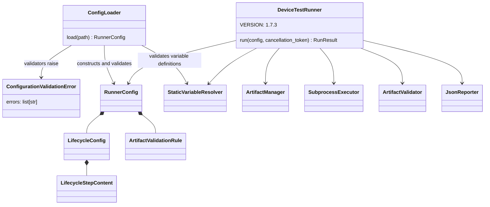
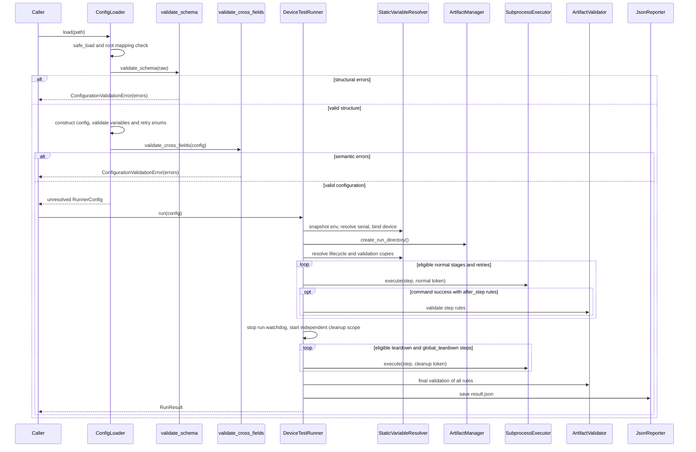

# Device Test Runner v1.7.3 Architecture

Scope: Configuration Validation. Based on source draft f56a44b, test draft ed6cf39, guide draft 66b37ff and current working tree. Release publication is unverified.

## Components and contract

ConfigLoader.load reads YAML, rejects non-mapping roots with ValueError, then calls validate_schema(raw). Structural errors raise ConfigurationValidationError before dataclass construction. Construction validates variable definitions and retry enums; these failures can stop loading before validate_cross_fields(config). The cross-field phase checks names, supported types, after_step references and artifact constraints before returning RunnerConfig. Each validator collects its own errors; phases do not merge error lists.

## Execution sequence

The diagram shows controlled paths. Construction and resolution exceptions propagate; unexpected exceptions are not guaranteed a report. Scope watchdogs, cancellation routing, retry policy and artifact reporting retain the [v1.7.2 execution architecture](architecture_v1.7.2.md).

## Compatibility and boundaries

Schema validation rejects unknown keys at every configured level, non-finite variables, numeric booleans, invalid collection shapes and whitespace-only required strings. Omitted stages become empty steps; a supplied stage must contain steps. Literal YAML step timeouts require integers >= 1; complete templates defer numeric checks to the resolver, which accepts finite positive int/float values. Optional scope timeouts permit null; numeric values must be finite and >= 1e-8.

Step names are unique across five stages; rule names are unique across rules. Only command and six artifact types are supported. after_step must exist outside cleanup stages. Extension/CSV/JSON types require their respective constraints, and min_size_bytes cannot exceed max_size_bytes. Fields irrelevant to a rule type are still accepted if their structural types are valid. retry_on membership is checked separately by the loader.

Direct Python dataclass construction and run() bypass these validators. Explicit validate_cross_fields(config) checks semantic relations, not full structural types. Templates are not evaluated by the schema; env presence, device context and resolved timeout types remain runtime checks. Schema/cross-field failures occur before the caller invokes run(), so no run directory or report is produced by loading. Later resolution errors may leave an empty directory. No JSON Schema export, command safety, file production or device connectivity verification is provided.

See [configuration guide](../variables/configuration_validation.md), [matrix](../test_matrix/test_matrix_v1.7.3.md) and [completion record](../definition_of_done/definition_of_done_v1.7.3.md).
