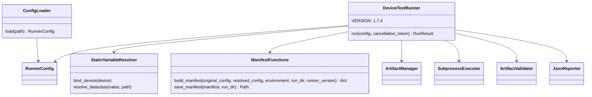

# Device Test Runner v1.7.4 Architecture

Scope: Execution Manifest. Source 0b72805, draft f6b05dd, tests 4b7fea4 and the current working tree. Release publication is unverified. Loader validation and lifecycle contracts retain the [v1.7.3 architecture](architecture_v1.7.3.md).

## Components



ManifestFunctions groups module-level functions in runner/manifest.py; it is not a Python class. build_manifest requires dataclass inputs, uses asdict, redacts referenced environment candidates, and hashes canonical UTF-8 JSON bytes. The original configuration is hashed but not persisted. The full resolved_config snapshot retains unresolved fields outside device, lifecycle and artifact.validation.

## Execution sequence

```mermaid
sequenceDiagram
    participant Caller
    participant Loader as ConfigLoader
    participant Runner as DeviceTestRunner
    participant Resolver as StaticVariableResolver
    participant Artifacts as ArtifactManager
    participant Manifest as runner.manifest
    participant Executor as SubprocessExecutor
    participant Validator as ArtifactValidator
    participant Reporter as JsonReporter
    Caller->>Loader: load(path), validate schema and cross-fields
    Loader-->>Caller: RunnerConfig
    Caller->>Runner: run(config)
    Runner->>Runner: retain original_config
    Runner->>Resolver: snapshot env, resolve device, bind context
    Runner->>Artifacts: create_run_directory(test_case_id)
    Runner->>Resolver: bind run.dir, resolve lifecycle and artifact.validation
    Runner->>Manifest: build_manifest(original, resolved, environment)
    Runner->>Manifest: save_manifest(PREPARED)
    loop eligible stages and attempts
        Runner->>Executor: execute(step, normal token)
        opt successful step with after_step rules
            Runner->>Validator: validate step rules
        end
    end
    Runner->>Runner: stop run watchdog, establish cleanup scope
    loop eligible teardown and global_teardown steps
        Runner->>Executor: execute(step, cleanup token)
    end
    Runner->>Validator: validate_all(rules, run_dir)
    Runner->>Runner: build RunResult
    Runner->>Reporter: save(result, output_dir)
    alt reporter succeeds
        Runner->>Manifest: save_manifest(COMPLETED, result_status, finished_at)
        Manifest-->>Runner: manifest path
        Runner-->>Caller: RunResult
    else reporter raises
        Reporter-->>Caller: exception; PREPARED remains
    end
```

The diagram represents controlled execution. Exceptions propagate; no outer finally guarantees manifest completion or a report. Initial saving precedes watchdog startup and subprocess execution. Final saving follows result.json; a final write error can leave a report with PREPARED manifest.

## Storage and boundaries

save_manifest writes a same-directory .manifest-*.tmp file, flushes and fsyncs it, then calls os.replace; finally removes a remaining temporary file. Directory fsync is absent. No manifest setting, CLI flag, RunResult field or result.json schema change is introduced. Both output files share the run directory.

Hashes cover redacted canonical dataclass settings, not YAML bytes or scripts. Resolved run paths affect the resolved hash. The current redaction loop returns after the first length-sorted candidate for each string; it does not guarantee masking all referenced values. Other outputs remain outside this mechanism. See [field and failure contract](../variables/executioin_manifest.md) and [coverage](../test_matrix/test_matrix_v1.7.4.md).
