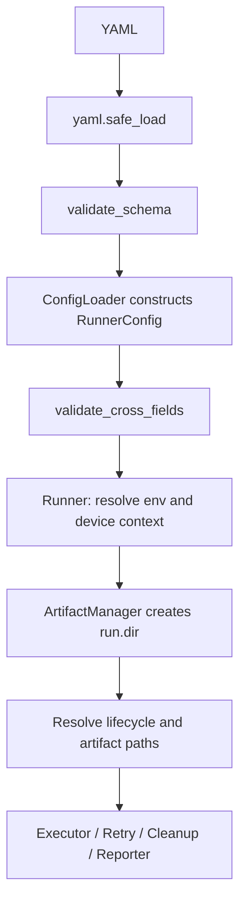

# Device Test Runner v1.7.3 — Configuration Validation

## Learning goals

Learn the difference between **structural schema** (field presence, shape, types, ranges) and **cross-field/semantic validation** (relationships between fields). Reject invalid YAML before a device is touched.

## Architecture



`runner/config_validation.py` contains both validators. `runner/config.py` calls them before returning `RunnerConfig`. The v1.7.2 variable resolver is unchanged. `runner/runner.py` changes only its version string to `1.7.3`.

## Example: valid YAML

```yaml
test_case:
  id: power_001
  name: Power regression
  description: Repeatable power test

device:
  serial: "${{ env.DEVICE_SERIAL }}"
  product: pixel
  build: development

variables:
  repeat: 3
  duration: 600

retry:
  max_attempts: 2
  delay_seconds: 1
  retry_on: [timeout, device_offline]

lifecycle:
  global_setup:
    steps: []
  setup:
    steps: []
  scenario:
    steps:
      - name: run_power
        type: command
        command: "python run.py --serial ${{ device.serial }} --repeat ${{ vars.repeat }}"
        timeout_second: "${{ vars.duration }}"
  teardown:
    steps: []
  global_teardown:
    steps: []

artifact:
  output_dir: ./artifacts
  validation:
    rules:
      - name: power_csv
        type: csv_content
        path: "${{ run.dir }}/result.csv"
        after_step: run_power
        required: true
        required_columns: [voltage, current]
        min_rows: 1
```

`run.py` is a user-provided script; this example demonstrates configuration validation, not a bundled power measurement script.

## Schema validation

Checks:

- Root sections: `test_case`, `device`, `lifecycle`, `artifact` required; `variables`, `retry`, and run/cleanup timeouts optional.
- Unknown fields are rejected (including nested fields), preventing silent typos.
- Required identity fields must be non-empty strings.
- Lifecycle stages are mappings with `steps` lists; each step requires `name`, `type`, `command` and may have `timeout_second`.
- `timeout_second` must be a positive integer or an entire `${{ ... }}` template; interpolated numeric text is not accepted.
- `retry.max_attempts` positive integer, `retry.delay_seconds` nonnegative finite number; bool is not accepted as number.
- Artifact rule fields have appropriate scalar/list/dict types; size limits and row counts are nonnegative integers.
- `variables` values must be finite YAML primitive scalars; the v1.7.2 resolver additionally rejects recursive references.
- Run and cleanup timeout values must be finite positive numbers.

**Important:** Schema validation allows an unresolved `${{ vars.duration }}` as a step timeout; `StaticVariableResolver.timeout()` validates the *resolved* integer later. The validator does not evaluate templates or inspect host environment variables.

## Cross-field validation

Checks:

- Step names unique across all five stages, because `after_step` references a step by name only.
- Artifact rule names unique.
- `after_step` references an existing step and cannot reference teardown/global_teardown for attempt-level validation.
- Supported step type: `command` (current executor behavior).
- Supported artifact types: `exists`, `file_size`, `file_extension`, `directory_not_empty`, `csv_content`, `json_content`.
- `min_size_bytes <= max_size_bytes` when both exist.
- `file_extension` requires nonempty `allowed_extensions`.
- `csv_content` requires `required_columns` or `min_rows`.
- `json_content` requires `required_json_paths` or `expected_json_values`.

These are explicit v1.7.3 policy decisions. If your lab intentionally reuses step names across stages, redesign `after_step` as a stage-qualified reference before relaxing uniqueness.

## Errors and diagnostics

`ConfigurationValidationError` stores an `errors: list[str]` and prints all errors from each validation phase, e.g.:

```
Invalid runner configuration:
- retry.max_attempts: expected integer >= 1
- artifact.validation.rules[0].required: expected boolean
```

The structural and cross-field phases run sequentially. The first failing phase stops the loader; it does not combine both phases' errors.

## Source integration

`runner/config.py`:

```python
from runner.config_validation import validate_schema, validate_cross_fields

# Immediately after yaml.safe_load and root mapping check:
validate_schema(raw)

# Build config using existing parser, then:
config = RunnerConfig(...)
validate_cross_fields(config)
return config
```

The included package already contains these edits. It retains the existing `variables.py`, `executor.py`, `artifact_validator.py`, cancellation and cleanup modules from v1.7.2.

## Testing

```bash
python -m pip install pytest pyyaml
cd dtr_v1_7_3
PYTHONPATH=. python -m pytest -q tests/
```

Tests cover invalid schema fields, aggregated errors, bad cross-field references, duplicates, artifact rule requirements, ConfigLoader integration and the previous v1.7.0–v1.7.2 end-to-end regression tests.

## Limitations and next steps

- This is a **Python schema validator**, not a published JSON Schema file or Pydantic model.
- It does not validate shell command safety, actual file existence, device connectivity or whether the referenced environment variable exists until runtime resolution.
- It does not check whether an artifact is genuinely produced by the referenced command.
- It does not validate that `artifact.output_dir` matches the `ArtifactManager` root (the current Runner receives ArtifactManager separately).
- Directly constructing `RunnerConfig` bypasses `ConfigLoader` validation. For strict programmatic callers, call `validate_cross_fields(config)` explicitly or introduce a dedicated configuration service.
- Existing runner resolves lifecycle/artifact templates after allocating `run.dir`; therefore a malformed runtime template can still create an empty run directory before failing. Schema/cross-field errors fail earlier.
- Consider adding a resolved-config validation pass and a JSON Schema export in a future version.
